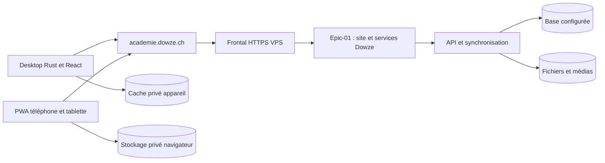

# Architecture — état réuni au 14 novembre 2026

## Composants

Le bureau utilise React/TypeScript dans une fenêtre Tauri 2 ; Rust fournit les fichiers, le coffre du système, les WebViews, le réseau et les commandes natives. La PWA possède son entrée `pwa/src/App.tsx` et réutilise des modèles de `src/lib/`. Le serveur FastAPI gère les comptes, sessions, espaces, documents de synchronisation, médias et carnets. Son stockage admet SQLite en développement et PostgreSQL via configuration ; les blobs restent dans un stockage distinct.

Le frontal HTTPS et le répertoire public Epic‑01 ont été observés directement. La base effective, les volumes privés, l’image API et leurs sauvegardes n’ont pas pu être inspectés avec les accès ordinaires. Le schéma représente les responsabilités du code, sans certifier ces détails d’exploitation actuels.

## Frontières

- L’interface locale appelle des commandes Rust validées ; les pages des fournisseurs utilisent des WebViews séparées.
- Sessions, comptes et documents doivent rester séparés par identité et espace. Les outils de note ne doivent pas devenir un second propriétaire de la sauvegarde.
- Le précache PWA concerne le shell et ses ressources ; il n’est pas une sauvegarde de la base utilisateur.
- Les carnets gérés exigent un démarrage scellé : code, worker Node et manifeste validés avant ouverture. Le démarrage de développement `app.main:app` ne reproduit pas cette garantie.
- Les configurations et clés privées de signature, de base ou de session restent hors du dépôt.

## Repères de code

| Emplacement | Rôle |
| --- | --- |
| `src/App.tsx`, `src/RootApp.tsx` | Espace de travail et authentification bureau |
| `src/components/` | Notes, cours, navigation, compagnon et interfaces |
| `src/lib/` | Modèles, persistance, protocoles et synchronisation |
| `src-tauri/src/` | Adaptations système et accès natifs |
| `pwa/src/` | Client web mobile/tablette |
| `server/api/app/main.py` | Construction de l’API et routes |
| `server/api/app/notebook_startup.py` | Vérification du runtime des carnets gérés |
| `server/api/app/config.py` | Configuration de stockage et limites |

Les identifiants historiques `com.etude.desktop` sont conservés pour la continuité des profils. Les anciens runtimes Hermes/mémoire volumineux ne sont pas des ressources de cette application (`bundle.resources` vide) et ne sont pas réintroduits.
