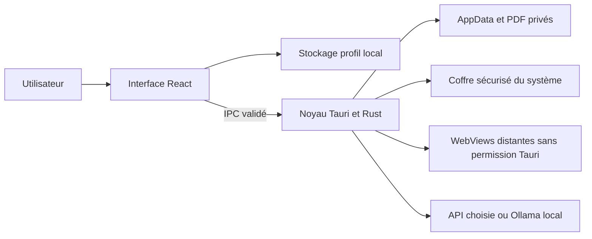

# Architecture

Dowze Academie est une application de bureau Tauri 2. L’interface React orchestre le cursus et l’état utilisateur ; la partie Rust fournit les opérations qui exigent une frontière native ou des contrôles renforcés.

## Technologies

- React 19 et TypeScript pour l’interface ;
- Vite 8 pour le serveur de développement et le bundle web ;
- Tauri 2 et Rust pour l’application native ;
- Milkdown/Crepe, ProseMirror, CodeMirror et KaTeX pour les notes ;
- Playwright et le test runner Node pour les validations.

## Organisation du dépôt

| Chemin | Responsabilité |
| --- | --- |
| `src/App.tsx` | Orchestration du workspace, états et workflows |
| `src/RootApp.tsx` | Barrière d’authentification et changement de profil |
| `src/components/` | Pages et composants de l’interface |
| `src/data/` | Cursus, notions et planning canoniques |
| `src/lib/` | Modèles, validation, persistance et prompts |
| `src-tauri/src/` | Comptes natifs, fichiers, WebViews, calendrier et réseau |
| `tests/` | Tests unitaires TypeScript et parcours UI Playwright |

## Frontières de confiance

### Interface locale

La fenêtre principale charge uniquement le bundle local. Elle possède les capacités Tauri minimales déclarées dans `src-tauri/capabilities/main-local.json`. Les commandes natives vérifient leur appelant et revalident leurs entrées.

### WebViews distantes

Les pages de fournisseurs sont chargées dans des WebViews séparées sans permission Tauri. La navigation, les nouvelles fenêtres, les téléchargements et les domaines sensibles sont filtrés côté Rust. Une transition de compte ferme les contenus distants avant d’afficher le profil suivant.

Sur macOS, l’accès vocal sépare trois frontières : seul le frontend local peut invoquer la demande TCC AVFoundation de l’application hôte, Wry décide ensuite de la permission média de l’origine WebKit, et la page distante ne reçoit toujours aucune permission Tauri. La demande native ne capture aucun son ; seule une fonction vocale déclenchée ensuite dans le site peut ouvrir le microphone.

### Persistance

Les données fonctionnelles sont préfixées par profil. Le registre de comptes natif conserve des vérificateurs Argon2id et s’écrit de façon atomique. Les PDF archivés sont rangés par compte et par évaluation. Les clés API et la reconnexion facultative utilisent le backend natif de `keyring` : Trousseau macOS, Gestionnaire d’identifiants Windows ou Secret Service Linux persistant. Aucun backend mock n’est activé dans les builds pris en charge.

Les identifiants historiques `etude.*`, `com.etude.*`, l’UID iCalendar et le bundle ID `com.etude.desktop` restent volontairement présents après le renommage. Ils assurent la continuité des profils, secrets et événements déjà créés ; ce ne sont pas les noms publics actuels du produit.

## Chat libre

Le frontend ne contacte pas directement les API distantes. Il transmet la requête à Rust, qui applique les limites de taille, la validation d’URL, la politique de redirection et les protections contre les destinations réseau privées. Ollama constitue l’exception locale explicitement bornée à `127.0.0.1:11434`.

## Mode navigateur

`npm run dev` sert à travailler sur l’interface. Les fonctions natives y utilisent des adaptations de développement : elles ne représentent ni le stockage Argon2id natif, ni le coffre sécurisé, ni l’isolation des fichiers, ni le comportement réel des WebViews système.

## Portabilité et livraison

Les intégrations propres à macOS restent derrière des gardes `cfg(target_os = "macos")`. La suppression ciblée des données Google utilise ainsi les API WebKit natives sur macOS et est annoncée indisponible sur les autres systèmes. Les opérations portables — profils, fichiers, PDF, calendrier, réseau et coffre sécurisé — sont compilées nativement sur les quatre jobs du workflow de release.

Les artefacts publics sont construits par GitHub Actions sur des runners macOS ARM64, macOS Intel, Windows x64 et Linux x64. La release reste en brouillon jusqu’à la réussite de toute la matrice et à la création d’un manifeste SHA-256.
